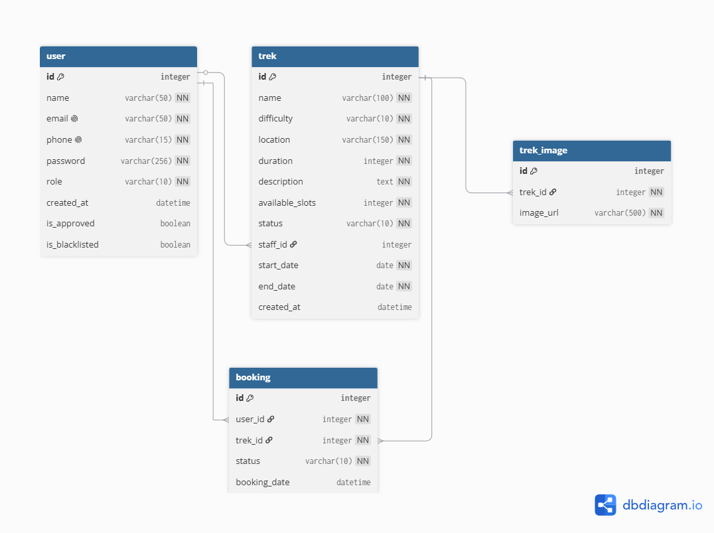

# trekking-management-application
Trekking Management Application

---

# Project Report

## 1. Student Details
- **Name:** Priyank Rajeshkumar Chapadiya
- **Roll Number:** 25f2009120
- **Email:** 25f2009120@ds.study.iitm.ac.in
- **Course:** Modern Application Development I
- **Project:** Trekking Management Application

---

## 2. Project Details

### Problem Statement
Adventure organizations currently rely on spreadsheets, phone calls, and manual coordination to manage trekking activities, making it difficult to handle trek approvals, track bookings, avoid overbooking, and maintain trek history. This project builds a role-based web application — **Trekking Management Application** — that lets an **Admin**, **Trek Staff**, and **Users (Trekkers)** each interact with the system according to their role, replacing manual coordination with a structured, auditable workflow.

### Approach
The application was built as Flask project structured around three role-base Blueprints(`admin`, `staff`, `users`) and a shared `authentication` blueprint, backed by a SQLite database. All core functionality are handled by HTML forms and server-side Flask logic.

## 3. AI/LLM Declaration
AI tools ChatGPT and Claude were used as **debugging tools and reference/research tools** during development — for example, as a substitute for searching YouTube tutorials/documentation on Flask, SQLAlchemy, and Flask Blueprints while learning the framework, and for help with CSS and styling the application's frontend. All core application logic, route structure, and database models were written and understood by me; AI assistance was used to debug, explain Flask blueprints and models, and assist with CSS/styling.

---

## 4. Frameworks and Libraries Used
- **Backend:** Flask
- **Database:** Flask-SQLAlchemy, SQLite
- **HTML Templating:** Jinja2
- **Frontend:** HTML, CSS, Bootstrap
- **No JavaScript** is used for any core functionality.

Full pinned list in `requirements.txt`.

---

## 5. ER Diagram



---

## 6. API Resource Endpoints
Not implemented in this submission — this was listed as a recommended/optional enhancement in the project brief, and the project scope was kept to the core Flask + Jinja2 server-rendered requirements.

---

## 7. Demo Video
Google Drive link: ``

---

## Project Structure
 
```
trekking_management_application/
├── app.py
├── models/
│   ├── __init__.py
│   ├── user.py
│   ├── trek.py
│   ├── booking.py
│   └── trek_image.py
├── blueprints/
│   ├── authentication.py
│   ├── admin.py
│   ├── staff.py
│   └── user.py
├── templates/
│   ├── base.html
│   ├── index.html
│   ├── authentication/
│   │   ├── login.html
│   │   ├── user_registration.html
│   │   └── staff_registration.html
│   ├── admin/
│   │   ├── dashboard.html
│   │   ├── users.html
│   │   ├── staff.html
│   │   ├── staff_approvals.html
│   │   ├── treks.html
│   │   ├── create_trek.html
│   │   ├── edit_trek.html
│   │   └── bookings.html
│   ├── staff/
│   │   ├── dashboard.html
│   │   ├── treks.html
│   │   ├── edit_trek.html
│   │   ├── participants.html
│   │   └── profile.html
│   └── user/
│       ├── dashboard.html
│       ├── treks.html
│       ├── bookings.html
│       └── profile.html
└── static/
    └── style.css
```